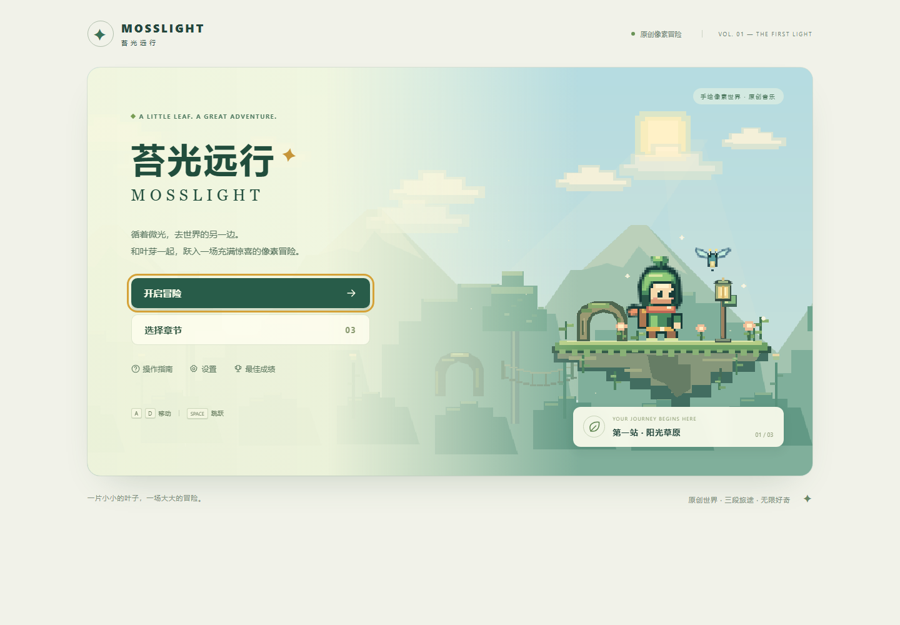
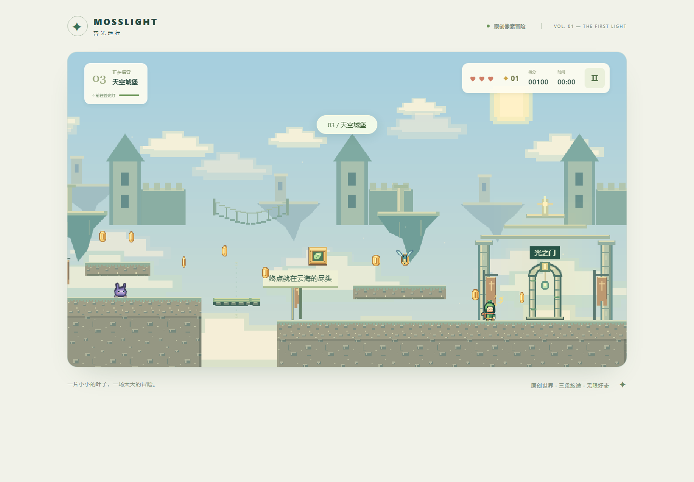

# 《苔光远行 · Mosslight》游戏体验优化报告

报告日期：2026 年 11 月 10 日。项目目录：`D:\数据\测试\Mario`。证据路径中的 `before/`、`after/` 分别简写 `artifacts/upgrade/before/`、`artifacts/upgrade/after/`；其他路径相对项目目录。

本报告是本地验收记录，完整原始日志与基线留在本地；公开源码仓库只附菜单和终点展示图，其余证据可通过文末命令重新生成。后续 GitHub Pages 发布记录见项目 README 和仓库 Actions，报告内“未远程部署”指本轮体验升级验收时的历史状态。

本次在既有 Phaser 3、TypeScript、Vite 项目上优化，保留“叶芽”、三关主题、原创程序化美术和 Web Audio 音乐。没有重建项目，没有引入商业素材或新的大型运行依赖。

**本轮交付完成：纯逻辑测试 32/32、Chromium 28/28、Edge 28/28 通过，TypeScript 与生产构建通过。已实际验证真实键盘三关流程、检查点失败重试、存档兼容、触屏事件和生产子路径；完成 60 秒前后基准及 120 秒压力采样。真人体验、手机真机与远程 GitHub 发布仍未验证。**

## 1. 基线保护与报告边界

正式修改前保存了可回查的源码、构建、参数、关卡、截图与测试证据：

| 内容 | 留档位置 |
| --- | --- |
| 原工作区状态 | `artifacts/upgrade/before/git-status.txt`，记录为 `?? Mario/` |
| 原源码与文件校验值 | `before/source.zip`、`before/reference/`、`before/source-hashes.json`，均位于 `artifacts/upgrade/` 下 |
| 原可运行静态构建 | `artifacts/upgrade/before/web.zip` |
| 原物理参数和关卡布局 | `artifacts/upgrade/before/config.ts`、`levels.ts` |
| 本轮修改前重新执行的测试 | `before/physics-tests.txt`：11/11；`before/browser-tests.txt`：16/16，53.1 秒 |
| 本轮修改前构建与运行采样 | `before/build.txt`、`before/runtime.json`、`before/physics-metrics.json` |
| 历史交付报告及 README | 原文件保留，并另存于 `artifacts/upgrade/before/reference/` |

`开发完成情况报告.md` 是此前可玩首版的历史交付记录。其 16/16、约 60 FPS 等数据不自动代表本次升级后的版本；本报告将重新采集的数据单列。没有为整理基线而清空工程、覆盖用户存档或自动提交工作区。

## 2. 已确认的问题与修复

| 已确认的问题 | 证据与修改 | 当前验证范围 |
| --- | --- | --- |
| 两次渲染之间完成的快速按下/松开可能丢失跳跃 | 原生键盘基线 12 次极短自动化点击中漏跳 1 次；`systems/input.ts` 增加按下/松开锁存，`motion.ts` 在一个固定步消费边沿，并保留短跳截断 | 同样 12 次后测未漏跳；另有原生浏览器与纯逻辑回归，不代表任意输入设备零漏跳 |
| 静止玩家可能被移动平台推入侧墙 | 原碰撞方向只看玩家 `vx`；离线场景中平台右移 5 px，玩家右边界侵入墙 2 px | 按包含平台位移的实际水平位移解碰撞；左右墙回归均覆盖 |
| 场景累加器在 144 Hz 的浮点边界少走一步 | 原 `Adventure.update` 精确模拟 2 秒时，30/60/120 Hz 为 240 步，144 Hz 为 239 步 | 加 `1e-10` 容差并约束余量；纯物理和实际场景累加器分别测试 |
| 音乐暂停只停止调度，已预约音符仍可能发声 | 时钟探针暂停后仍有 2 个待发声节点，最晚停止时间 0.57 秒 | 跟踪音乐/SFX 节点并淡出取消；后测待发声为 0，停止预约为 0.015 秒 |
| 重试可能遇到残留失败计时或旧受伤外观 | 检查点重试现在显式移除失败 Timer，重置反馈、透明度、缩放与镜头，立即同步精灵位置 | `experience.spec.ts` 隔离复现死亡后立即重试并等待，未出现旧失败弹窗 |
| 完成当帧立刻重开可能留下待插入结算 Timer | 直接调用实际 Phaser Clock：`delayedCall → removeAllEvents → preUpdate` 后旧回调仍执行；该 API 只移除 active 队列 | `loadLevel` 加 `clearPendingEvents()`，结算回调检查模式；新增浏览器回归 |

升级整合时还发现并修复两处新功能接线问题：主菜单修改画面设置没有通知场景；减少动态效果分支未同时遵守全局粒子上限。现在设置事件在菜单即时应用、暂停状态保持暂停；所有特效模式均受 96 个活动粒子上限约束。这两项不冒充原版已经存在的问题。

暂停/恢复仍重置键盘与触控状态；Esc、R 及跳跃使用原生事件去重，避免 Phaser 队列重复访问同一事件。外部 `blur`、`visibilitychange`、设置监听在场景关闭/销毁时移除。有限回归未发现新的阻断问题，但不据此宣称不存在任何 Bug 或泄漏。

## 3. 水平运动与跳跃参数

参数集中在 `src/game/config.ts`。单位：位置 px、速度 px/s、加速度 px/s²、时间秒。改变的是反向制动和地面松键减速；已有速度与跳跃包络保持不变。

| 参数 | 优化前 | 优化后 | 选择理由 |
| --- | ---: | ---: | --- |
| 固定步长 `step` | 1/120 | 1/120 | 保留成熟架构 |
| 步行 / 疾跑上限 | 245 / 340 | 245 / 340 | 保留关卡节奏与跳远能力 |
| 地面 / 空中同向加速度 | 1900 / 1350 | 1900 / 1350 | 起步速度已有足够响应 |
| 地面反向加速度 | 1900，共用同向值 | 3400 | 缩短反向打滑 |
| 空中反向加速度 | 1350，共用同向值 | 1950 | 增加修正落点能力 |
| 地面松键减速 | 2100 | 2500 | 疾跑急停约一个碰撞体宽度 |
| 空中松键减速 | 735，即 2100×0.35 | 735，独立配置 | 避免地面修改意外影响空中 |
| 上升 / 下落 / 顶点重力 | 1450 / 1750 / 1050 | 1450 / 1750 / 1050 | 保留现有高低跳差异 |
| 起跳速度 / 松键截断系数 | 550 / 0.46 | 550 / 0.46 | 不改变已设计的跳跃高度 |
| 最大下落速度 | 720 | 720 | 保留碰撞安全边界 |
| Coyote Time / Jump Buffer | 0.11 / 0.13 | 0.11 / 0.13 | 保留离台与提前输入宽容 |
| 玩家碰撞体宽×高 | 22×34 | 22×34 | 视觉形变不能改变碰撞 |

可复现指标来自 `scripts/physics-metrics.ts` 与 `before/physics-metrics.json`、`after/physics-metrics.json`。在平面、120 Hz、无敌人/道具干扰下测量；反向制动从满速开始，完整反向指达到反方向同档满速。短跳持键 2 个物理步，长跳持续持键；水平跳远从该档满速起跳。

| 实测指标 | 优化前 | 优化后 |
| --- | ---: | ---: |
| 步行 / 疾跑达到上限 | 133.33 / 183.33 ms | 133.33 / 183.33 ms |
| 步行松键停止时间 / 距离 | 116.67 ms / 13.27 px | 100.00 ms / 11.00 px |
| 疾跑松键停止时间 / 距离 | 166.67 ms / 26.13 px | 141.67 ms / 21.72 px |
| 步行反向到零 / 原方向滑行 | 133.33 ms / 14.72 px | 75.00 ms / 7.75 px |
| 疾跑反向到零 / 原方向滑行 | 183.33 ms / 28.95 px | 108.33 ms / 15.35 px |
| 步行 / 疾跑完整反向 | 258.33 / 358.33 ms | 200.00 / 275.00 ms |
| 空中疾跑反向到零 / 滑行 | 258.33 ms / 41.33 px | 175.00 ms / 28.22 px |
| 短跳高度 / 步行水平距离 | 28.03 / 89.83 px | 28.03 / 89.83 px |
| 长跳高度 / 步行水平距离 | 102.83 / 183.75 px | 102.83 / 183.75 px |
| 疾跑长跳水平距离 | 255.00 px | 255.00 px |
| 短跳 / 长跳滞空时间 | 366.67 / 750.00 ms | 366.67 / 750.00 ms |
| 短跳 / 长跳达到顶点 | 183.33 / 391.67 ms | 183.33 / 391.67 ms |
| 物理输入到起跳 | 首个固定步，≤8.33 ms | 首个固定步，≤8.33 ms |

疾跑急停距离减少约 16.9%，反向制动滑行减少约 47.0%。这是可测量的控制变化；“更舒服”仍需玩家试玩确认。30/60/120/144 Hz 的相同输入调度在后测均执行 240 步，最终位置、速度及跳跃最高点一致。指标脚本使用容差累加器；原场景的少一步问题另存于 `before/accumulator-schedule.json`，不以脚本的一致性掩盖它。

浏览器输入另测：`before/input-response.json` 与 `after/input-response.json` 中极短点击从 1/12 漏跳变为 0/12；后测 14 个成功样本的事件至首个 `postrender` 位移约 0.7–5.2 ms。它受自动化、事件到达相位与环境影响，不是键盘硬件到屏幕发光延迟，也不说明延迟比原版更低。零等待自动化点击与上表两步短跳不同，不能混作同一高度实验。

## 4. 镜头、动作和反馈

| 原表现 / 目标 | 已实现的修改 | 代码 |
| --- | --- | --- |
| 跟随方向与可见落点需改善 | 按速度前瞻 0.36 秒，最多 130 px；24 px 死区；按时间指数平滑并限制世界边界 | `systems/camera.ts` |
| 避免每次跳跃上下晃动 | 常规跳跃保持地平线；快速下落时最多向下预览 36 px；减少动态时关闭该预览 | `systems/camera.ts` |
| 落地反馈不区分轻重 | 固定步记录实际落地速度，形变最多约 13%，落地姿态 75 ms，尘土随冲击调整 | `physics/motion.ts`、`effects/playerFeedback.ts` |
| 跑步帧率与实际速度脱节 | 动画相位按行进距离推进；疾跑尘土间隔 130 ms | `effects/playerFeedback.ts`、`scenes/Adventure.ts` |
| 动画可能覆盖跳跃状态 | 空中姿态优先于未结束的落地姿态；起跳、踩怪反弹及时触发视觉反馈 | 同上 |
| 受伤和奖励反馈需要清晰 | 200 ms 受伤姿态、较低频透明度提示、HUD 保护状态；方块轻微形变、宝箱开启纹理、强化方块专属标记 | 场景、纹理、HUD |

镜头与形变只改显示，不写回碰撞体或延迟真实起跳；没有加入输入前摇或冻结游戏的特写。新纯逻辑测试覆盖镜头方向、边界、不同 dt、空中动画优先级、按距离跑步和视觉缩放不修改 Body。

## 5. 美术、关卡引导和界面

草原增加有层次的植被和轻微摇摆；洞穴增加冷色装饰晶体及柔和辉光，危险晶刺使用暖珊瑚色；天空增加旗帜、远景层次与终章拱门。移动平台显示点状行程及端点，秘密宝箱与终点有克制的提示光。纹理由程序生成并缓存，没有把背景装饰加入碰撞体。

关卡采用保守调整：对照保存的 `levels.ts`，三关的平台、移动周期、方块、敌人、危险区、出生点、检查点、终点、宝箱均未改变。精简指引文字并调整金币弧线；金币数量为草原 31→32、洞穴 37→37、天空 47→48。检查点仍在 x=1850、1820、2040。没有为测试通过降低敌人强度或搬动地形；关卡乐趣和难度舒适度尚不能由可达性证明。

UI 保留奶油白与苔绿色，增加更明确的按钮焦点/按下反馈、弹窗焦点约束和关闭后的焦点恢复。HUD 增加检查点、旅程进度、强化倒计时与受伤保护提示；选关卡片显示成绩、时间和完成状态。失败界面说明深坑/敌人/机关原因及实际重生位置，默认聚焦重试，Enter 可重试，失败等待缩短为 320 ms。

最终截图检查还修复了残留入关/奖励提示条遮挡对话框标题的问题：打开弹窗即清除提示。草原与天空的两处路牌移动到金币弧线之外，保留金币数量和全部碰撞布局。

设置新增屏幕震动开关、减少动态效果、完整/精简效果质量；支持主菜单即时生效和暂停后继续保留。减少动态降低形变、环境动画、粒子位移及闪烁，并关闭震动。沿用 `mosslight-save-v1`，旧存档缺失的新字段使用默认值，保留解锁和分数/金币/时间记录。

触控使用独立指针集合，支持方向、疾跑、跳跃同时按下；取消、丢失捕获、失焦与弹窗切换均释放状态。适配安全区域，竖屏保留独立操作区及横屏提示；横屏和高 DPI 调整控件与视野比例。验证范围是浏览器模拟，未声称完成真实手机测试。

## 6. 音频和资源管理

保留三关原有原创旋律，增加少量低音和辅助音色；音乐、音效分总线，经压缩器限制叠加峰值。音量变化采用短平滑，音效设置最短触发间隔，音乐/SFX 活动节点分别限制为 8/12；节点结束后断开并释放引用。

暂停取消已预约音符和短音效，继续从下一节拍恢复；重开/切关停止旧调度与声音。`before/audio-baseline.json`、`after/audio-regression.json` 是时钟探针，`ui-upgrade.spec.ts` 还覆盖浏览器原生 Web Audio 调度与上限。这些证据能验证节点和调度状态，不能替代真人对爆音、配乐与听感的评估。

压力采样发现 CDP `AudioHandlers` 从 24 增至 428，因此追加了实际回收探针，未忽略这一现象。该指标表示当前原生实例数，非累计创建量，参见 [Chromium 实现](https://raw.githubusercontent.com/chromium/chromium/main/third_party/blink/renderer/modules/webaudio/audio_handler.cc)。`scripts/audio-lifecycle-probe.mjs` 连续三轮播放、换关并触发高频音效，共创建 887 个振荡器；每轮停止声音、等待 1 秒、GC 后再等待 300 ms，实例均回到 4，振荡器弱引用为 0，Gain 弱引用为 2（音量总线），调度与活动声音为 0，监听数回到 78。还直接观察到 GC 返回时计数尚高、稍后下降的异步销毁现象。证据在 `after/audio-lifecycle.json`；本轮未复现不可回收增长，因此没有为猜测中的泄漏改动音频源码。

粒子按活动数限额 96；精简模式每次约 40%，减少动态单次最多 3 个且仍遵守总限额。场景重载显式销毁显示对象、补间和计时器；环境偏好注册表每次重建，纹理按键复用。后测跨三关重建 20 次再回到同关：显示对象 189→189，纹理 101→101，Space 监听 1→1，补间 25→25；饱和粒子峰值 96，结束后对象数恢复。见 `after/resource-stress.json`，不将有限计数检查等同于完整内存泄漏证明。

## 7. 测试结果及未决项

| 检查 | 本轮实际状态 / 证据 |
| --- | --- |
| 修改前物理与地形路线 | 11/11 通过，`before/physics-tests.txt` |
| 修改前 Chromium | 16/16 通过，53.1 秒，`before/browser-tests.txt` |
| 修改后物理、路线、镜头反馈和测试驾驶器 | **32/32 通过**，`after/physics-tests.txt`；保留原测试并补充回归，其中一个驾驶器用例覆盖 420 组输入观察条件 |
| 三关纯地形路线 | 9.42 / 11.38 / 13.29 秒到终点；不含敌人交互，不是玩家通关时间 |
| 首轮完整 Chromium 升级回归 | **27/28 通过**；原生路线第二关 x≈2229.5 处死亡，`after/browser-chromium-initial.txt` 与 `after/native-initial-failure/` 保留证据 |
| 原生路线与测试驾驶器修正 | 洞穴调整移动台起跳策略；修复驾驶器停在 x≈1861、触发范围外且不回走的问题，用实际物理校验 420 组观察条件；保留中间失败日志 `browser-chromium-route-retry.txt`、`browser-chromium-driver-stop.txt`。未改变地图、敌人、伤害或检查点容差 |
| 本轮最终完整 Chromium | **28/28 通过，约 2.1 分钟**；`after/browser-chromium.txt`，结果与逐关轨迹位于 `after/chromium-results/` |
| 本轮最终完整 Edge | **28/28 通过，约 1.7 分钟**；`after/browser-edge.txt`，结果与逐关轨迹位于 `after/edge-results/` |
| TypeScript + Vite 构建 | 已通过，`after/build.txt`；应用 JS 80.79 kB、CSS 32.37 kB，Phaser 独立包 1208.06 kB（均为未压缩构建大小） |
| GitHub Pages 子路径生产包 | Chromium、Edge 均通过 `/sample-game/` 加载、原生键盘拾币、无 4xx/运行时错误、无开发测试接口；`after/production-chromium.json`、`after/production-edge.json` |
| 触屏、旧存档、焦点、声音 | 原生多触点、旧档迁移、新设置保存、Tab/Escape、Enter 重试、原生音频节点取消及 DPR 2/3 布局均包含在两个浏览器通过的完整套件中 |

测试证据有三种层次：`routes.test.ts` 为纯地形物理；`journey.spec.ts` 直接驱动固定步输入，保留真实敌人与伤害；`native-journey.spec.ts` 通过 Playwright 键盘控制角色，读取状态辅助驾驶，不直接模拟步进、传送或赋予无敌。其目标是覆盖含失败重试的完整玩家流程，不是证明每次必定一次通关或无伤。机制专项测试可能设置初始位置；截图脚本也直接切关/设置终点，只用于视觉采集，不能作为原生连续通关证据。

最终真实键盘结果：

| 浏览器 / 关卡 | 游戏时间 | 结算生命 / 金币 | 真实失败重试 |
| --- | ---: | ---: | ---: |
| Chromium · 草原 | 10.24 秒 | 2 / 23 | 0 |
| Chromium · 洞穴 | 11.60 秒 | 2 / 29 | 0 |
| Chromium · 天空 | 19.40 秒 | 2 / 36 | 1 |
| Edge · 草原 | 10.13 秒 | 2 / 23 | 0 |
| Edge · 洞穴 | 11.45 秒 | 2 / 28 | 0 |
| Edge · 天空 | 13.95 秒 | 1 / 31 | 0 |

Chromium 天空关在 x≈3489 因敌人耗尽生命，实际点击“再次出发”，验证从 x=2072、3 生命恢复且金币/分数/时间保留，然后走完剩余路线。两个浏览器均通过下一章按钮解锁，最终刷新后保留三关记录；草原实际踩踏了敌人。所有通关断言保持严格，未用重试失败冒充通关。

## 8. 性能和截图

| 同类运行采样 | 优化前重新采集 | 优化后 |
| --- | ---: | --- |
| 桌面固定场景时长 / 渲染帧 | 60.01 秒 / 3596 帧 | 60.01 秒 / 3600 帧 |
| 帧间隔中位数 / P95 / P99 | 16.70 / 18.00 / 18.80 ms | 16.70 / 17.90 / 18.60 ms |
| 场景对象 / 纹理 / R 监听 | 162 / 75 / 1，60 秒内不增长 | 174 / 84 / 1，60 秒内不增长 |
| 运行时异常 | 0，`before/runtime.json` | 0，`after/runtime.json` |
| 120 秒跨关与粒子压力采样 | 无同类基线，不作直接提升百分比 | 7201 帧，中位数 16.70 ms、P95 17.80 ms、P99 18.30 ms；0 异常，`after/soak.json` |

桌面表现维持约 60 FPS；P95 的 0.1 ms 差异不足以证明显著提速。新增环境资源使对象和纹理增加，但在样本内保持有界。压力采样每 20 秒切关、每 5 秒触发饱和粒子，三关各出现两轮；静止时对象数分别为 174/157/189，纹理为 84/93/101，第二轮回到同关时相同，R 监听一直为 1。采样前后执行 GC，采样中不主动 GC；这些有限指标不能替代小时级泄漏剖析。

手机/平板均为 Windows Chromium 触屏模拟，DPR 2，每个尺寸采集 120 个实际 `postrender` 帧，逐页独立运行：

| 视口 | 中位数 | P95 |
| --- | ---: | ---: |
| 320×568 | 16.70 ms | 18.30 ms |
| 390×844 | 16.80 ms | 18.10 ms |
| 844×390 | 16.90 ms | 18.60 ms |
| 1024×768 | 16.90 ms | 18.50 ms |

首次手机采样误留了同时渲染的桌面页，中位数约 28 ms。关闭桌面页后重新采样得到上表；原始结果保留于 `after/runtime-multi-page-touch.json`，避免把测试装置的资源争抢当成移动设备性能。DPR 3 另有交互与布局测试。以上不能代表真实手机的温控、GPU 或触控延迟。

截图索引：修改前 `before/menu-settled.png`（从原源码快照补拍的稳定菜单）、`level-1.png`～`level-3.png`、`level-select.png`、`complete.png`；手机/平板 `touch-320x568.png`、`touch-390x844.png`、`touch-844x390.png`、`touch-1024x768.png`。上述路径均在 `artifacts/upgrade/` 内，最早的 `before/menu.png` 处于菜单进入转场中，也一并保留。

最终后测同名截图已齐全：`after/menu.png`、`level-1.png`～`level-3.png`、`level-select.png`、`complete.png`、四种 `touch-宽x高.png`，另有 `sky-finale.png`、`ui-settings.png` 和 DPR 3 的触屏截图。已逐项检查主要画面；结算截图通过视觉夹具到达终点，因此截图中的 1 秒/少量金币不代表玩家通关记录。原生完整旅程的成绩和截图在浏览器测试结果目录中。





## 9. 复验命令与部署

本轮实际调用已安装的 Node 工具入口执行类型检查、构建、32 项纯逻辑测试和 Playwright（当前宿主没有独立的 `npm` 命令）：

```powershell
node node_modules/typescript/bin/tsc --noEmit
node node_modules/vite/bin/vite.js build
node node_modules/tsx/dist/cli.mjs --test tests/physics.test.ts tests/routes.test.ts tests/camera-feedback.test.ts tests/native-driver.test.ts
node node_modules/@playwright/test/cli.js test
$env:PW_CHANNEL='msedge'; node node_modules/@playwright/test/cli.js test
Remove-Item Env:PW_CHANNEL -ErrorAction SilentlyContinue
node scripts/check-production.mjs
node scripts/input-response.mjs after
node scripts/capture-experience.mjs after
node scripts/soak-experience.mjs
node scripts/audio-lifecycle-probe.mjs
```

在项目根目录的 Windows PowerShell 执行；性能采样与完整浏览器回归应顺序运行，避免资源争抢污染数值：

```powershell
npm ci
npm run dev
# 以下测试在另一终端运行；Playwright 可按配置启动测试服务器。
npx playwright install chromium
npm run test:physics
npm run measure:physics
npm test
$env:PW_CHANNEL='msedge'; npm test
Remove-Item Env:PW_CHANNEL -ErrorAction SilentlyContinue
npm run build
npm run test:production
npm run measure:experience
node scripts/soak-experience.mjs
```

`measure:physics` 和 `measure:experience` 默认写入 `artifacts/upgrade/after/`。不要用修改后的代码覆盖 `before/` 基线。浏览器完整日志见 `playwright-report/`、`test-results/` 和留存文本；Edge 命令需要本机已经安装 Edge。

GitHub Pages 仍使用 `.github/workflows/deploy.yml`：推送指定主分支后安装锁定依赖、运行纯逻辑测试、构建并部署。仓库需在 Settings → Pages 选择 GitHub Actions。**尚未提供用于发布的仓库信息，本次没有远程部署，也不预设公开访问地址。**

## 10. 限制与下一轮工作

- 自动驾驶仍是观察坐标后控制按键的测试工具，不能替代真人对第三关节奏的评价；原始失败、控制策略修复、最终成功及真实重试证据均保留。
- 未进行真人盲测：应邀请不同熟练度玩家记录首次死亡位置、短跳理解、金币引导与检查点重复路程，再决定是否改变地形。
- 未进行 iOS/Android 真机、触控延迟和低端 GPU 实测；浏览器覆盖 320×568、390×844、844×390、1024×768 及 DPR 2/3 不能替代这些设备。
- 尚无小时级耐久运行与系统级内存剖析；现有 60 秒基准、有限重建、已执行的 120 秒压力采样各自只支持对应范围结论。
- 暂未加入按键重设、手柄、云存档或新关卡。优先完成真人关卡节奏/音乐听感评估及真机性能检查，再考虑这些扩展。

